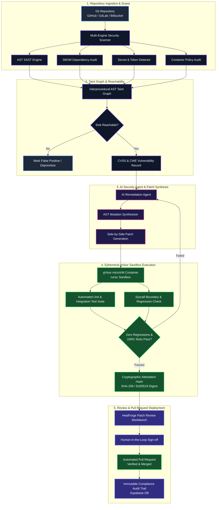
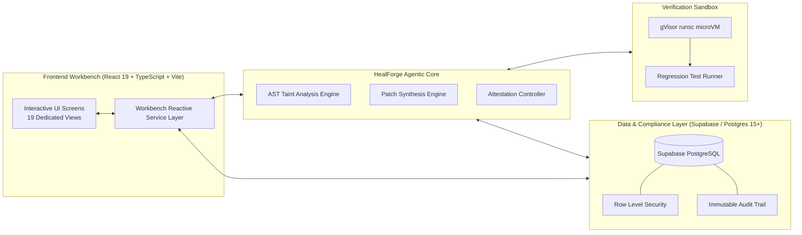

# 🛡️ HealForge — Autonomous Code Security & Remediation Workbench

<p align="center">
  
</p>

<p align="center">
  <strong>Autonomous vulnerability detection, interprocedural AST taint tracking, automated patch synthesis, and ephemeral gVisor microVM verification.</strong>
</p>

<p align="center">
  <a href="https://react.dev/"></a>
  <a href="https://www.typescriptlang.org/"></a>
  <a href="https://vite.dev/"></a>
  <a href="https://tailwindcss.com/"></a>
  <a href="https://supabase.com/"></a>
  <a href="https://gvisor.dev/"></a>
  <a href="https://oxc.rs/"></a>
  
</p>

---

## 📌 Executive Summary

Modern static application security testing (SAST) tools overwhelm engineering teams with hundreds of noisy, unvalidated vulnerability alerts. **HealForge** closes the loop between **vulnerability discovery** and **production-grade remediation**. 

By uniting **deep Abstract Syntax Tree (AST) taint analysis** with **autonomous patch synthesis** and **isolated microVM sandbox verification (`gVisor runsc`)**, HealForge ensures every proposed fix is mathematically traced, syntax-safe, and cryptographically attested to be **regression-free** before hitting human code review.

---

## 📐 System Architecture & Visual Flowcharts

### 1. Autonomous Remediation Lifecycle



---

### 2. Full-Stack Component Interaction



---

## ✨ Key Capabilities & Workbench Modules

HealForge is designed around **19 cohesive workbench modules** divided into 5 operational domains:

```
├── 🏢 Workspace
│   ├── 📊 Dashboard: Unified posture metrics, MTTR velocity, active sandboxes, repo health
│   ├── 📁 Repositories: Branch protection policies, health scores, automated scan triggers
│   ├── 🐛 Bug Report Intake: Security triage form with PoC attachments and automated reproduction
│   └── 🔍 Vulnerabilities: Deep vulnerability catalog with CVSS metrics and CWE/CVE mapping
│
├── 🤖 AI Security Agent
│   ├── ⚡ Security Scans: Multi-engine configurator with live terminal log streaming
│   ├── 🔬 Code Explorer: 3-panel AST investigation environment with line sink highlights
│   ├── 🔄 Patch Review: Side-by-side AST mutation diff viewer with rationale inspection
│   └── ⏱️ Agent Activity: Multi-stage trace logs, timing metrics, and tool execution history
│
├── 🛡️ Validation & Results
│   ├── 🧪 Verification & Sandbox: Ephemeral gVisor microVM runtime testbed with live logs
│   ├── 📜 Verified Fixes: Attestation proof registry documenting zero regressions
│   ├── 📜 Scan History: Historical run deltas and commit-to-commit comparison tools
│   ├── 🧠 Security Intelligence: OWASP Top 10 and CWE Top 25 density analytics
│   └── 📑 Reports & Audit Trail: Cryptographic audit trail and downloadable executive PDFs
│
├── ⚙️ Enterprise Integrations & Account Center
│   ├── 🔑 Personal Access Tokens (PAT) & API Key Management
│   ├── 🔐 TOTP Two-Factor Authentication & Active Session Management
│   ├── 👥 Role-Based Access Control (RBAC): Owner, Admin, Security Engineer, Dev, Viewer
│   └── 🔔 Real-time Webhooks & SIEM / Slack / Jira Event Dispatchers
│
└── 🌐 Immersive Homepage
    └── Cinematic technical showcase featuring animated taint-flow graphs & live telemetry
```

---

## 🛠️ Technology Stack

| Layer | Technology | Purpose |
| :--- | :--- | :--- |
| **Frontend Framework** | [React 19](https://react.dev/) | Latest concurrent React primitives and seamless component lifecycle |
| **Language** | [TypeScript 5.x / 6.x](https://www.typescriptlang.org/) | End-to-end type safety, strict compile checks, and robust data schemas |
| **Build & Tooling** | [Vite 8](https://vitejs.dev/) | Lightning-fast HMR and optimized production asset bundling |
| **Styling & Design** | [Tailwind CSS v3](https://tailwindcss.com/) | Bespoke cyber-security aesthetic with dark mode and high-contrast telemetry |
| **Database & Auth** | [Supabase](https://supabase.com/) / [PostgreSQL 15+](https://www.postgresql.org/) | Multi-tenant schema, pgTAP unit tests, and Row Level Security (RLS) |
| **Verification Runtime** | [gVisor `runsc`](https://gvisor.dev/) | Application-level microVM sandbox providing syscall isolation |
| **Code Quality** | [Oxlint](https://oxc.rs/) | Blazing-fast Rust-based static code linter |
| **Architecture** | Reactive Service Layer | Event subscription pattern with synchronized local and cloud state |

---

## 🚀 Quickstart & Local Development

### Prerequisites

Ensure you have the following installed on your development machine:
- **Node.js**: `v20.x` or `v24.x` (LTS recommended)
- **npm**: `v10.x` or `v11.x` (or `pnpm` / `bun`)
- **Docker** / **gVisor** *(optional, for running local microVM sandbox tests)*
- **Supabase CLI** *(optional, for local database migrations)*

### 1. Clone & Install

```bash
# Clone the repository
git clone https://github.com/Rohi56u/healforge.git
cd healforge

# Install frontend dependencies
npm install
```

### 2. Run the Development Server

```bash
# Start Vite development server
npm run dev
```

Visit [`http://localhost:5173`](http://localhost:5173) in your browser.

To expose the development server to your local network:
```bash
npm run dev -- --host
```

### 3. Build & Quality Checks

```bash
# Typecheck with TypeScript and build production bundle
npm run build

# Run fast code linting via Oxlint
npm run lint

# Preview production build locally
npm run preview
```

---

## 🗄️ Database Foundation & Schema Architecture

HealForge includes an enterprise-grade Supabase / PostgreSQL foundation located in `supabase/migrations/`:

```
supabase/
├── migrations/
│   ├── 20261027120000_core_schema.sql           # Workspaces, Scans, Vulnerabilities, Sandboxes, Attestations
│   ├── 20261027120100_functions_and_triggers.sql # Automated status updates, audit triggers, metrics calculation
│   └── 20261027120200_row_level_security.sql    # Multi-tenant tenant-isolation RLS policies
├── tests/
│   ├── 01_schema_structure.test.sql             # pgTAP schema verification
│   ├── 02_security_rls.test.sql                 # Row Level Security isolation test suite
│   ├── 03_immutability_and_dedup.test.sql       # Attestation & audit log tamper resistance
│   └── 04_behavioral_security.test.sql          # State transitions and automated rollback tests
└── seed.sql                                     # Rich demo seeds for instant testing
```

To run the database test suite:
```bash
npm run test:db
```

---

## 🔒 Security Model & Cryptographic Attestation

Every automated remediation synthesized by HealForge undergoes a four-step verification protocol:

1. **AST Taint Path Containment**: Confirms that the mutation breaks the source-to-sink dataflow path without altering unrelated abstract syntax nodes.
2. **Deterministic gVisor microVM Execution**: Evaluates the patch against all existing unit and regression tests in a strictly isolated `runsc` sandbox with filtered system calls.
3. **Attestation Signature Generation**: Computes a cryptographic checksum (`SHA-256` / `Ed25519`) of the patch contents, test logs, container exit codes, and AST diff.
4. **Immutable Audit Registration**: The signature is recorded in an append-only PostgreSQL ledger, ensuring zero tampering prior to human sign-off.

---

## 🗺️ Roadmap

- [x] Multi-engine scan orchestration (AST SAST, SBOM, Secrets, Container).
- [x] Ephemeral sandbox telemetry streaming & attestation digest generator.
- [x] 19-screen workbench UI with full Account Center and RBAC controls.
- [x] Supabase multi-tenant schema with comprehensive RLS and pgTAP test coverage.
- [ ] Direct GitHub App bidirectional integration for real-time PR status checks.
- [ ] Dynamic WebAssembly (Wasm) in-browser AST parser preview.
- [ ] eBPF runtime observability inside live production environments.

---

## 🤝 Contributing

Contributions to **HealForge** are warmly welcomed! Please observe the following workflow:

1. **Fork the Repository** to your own GitHub account.
2. **Create a Feature Branch**:
   ```bash
   git checkout -b feature/amazing-security-feature
   ```
3. **Commit Your Changes**: Follow conventional commit guidelines (`feat:`, `fix:`, `docs:`, `test:`).
   ```bash
   git commit -m "feat(agent): enhance AST mutation validator for prototype pollution"
   ```
4. **Run Verification & Tests**:
   ```bash
   npm run build
   npm run lint
   ```
5. **Open a Pull Request**: Submit your PR with a clear description of the problem solved and test evidence.

---

## 📄 License

This project is licensed under the [MIT License](LICENSE) (or Internal Proprietary specifications where designated). See repository headers for details.

---

<p align="center">
  Crafted with precision for modern Application Security & DevSecOps engineering teams.
</p>
