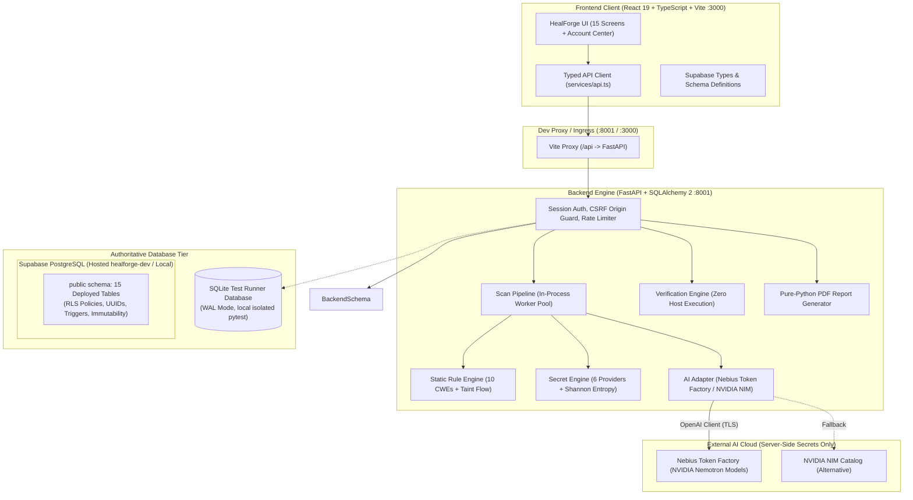
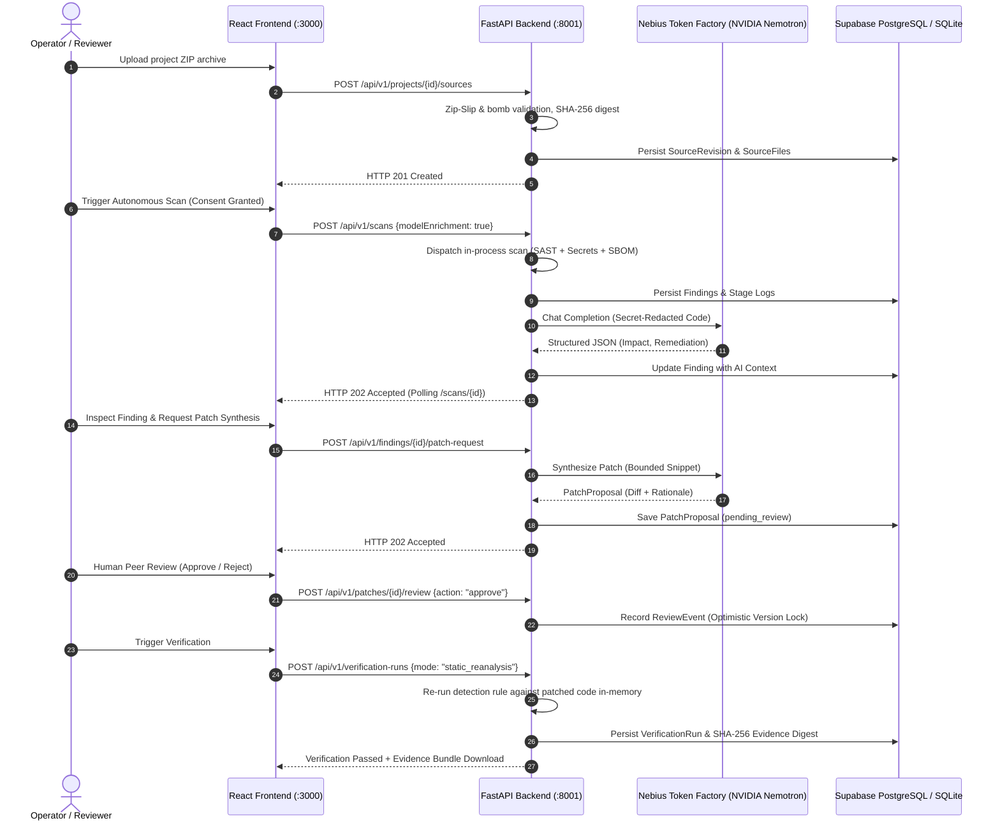

# HealForge — Autonomous Code Security & Remediation Workbench

HealForge is an autonomous code security analysis and remediation platform. It bridges the gap between vulnerability detection and patch verification through interprocedural static analysis, secret detection, AI-assisted investigation and patch synthesis via **Nebius Token Factory**, human-in-the-loop review, and verifiable patch attestation — with **zero execution of untrusted code on the host**.

---

## Architecture Overview



---

## 1. Quick Start (Local Development)

### Prerequisites
- Node.js 20+ and npm 10+
- Python 3.12+ (or Homebrew `/opt/homebrew/bin/python3.12`)

### Fast Start (Automated Concurrent Dev)
```bash
# 1. Setup virtual environment, pinned dependencies, SQLite migrations, and npm
./dev.sh setup

# 2. Run both FastAPI backend (:8001) and Vite frontend (:3000) concurrently
./dev.sh
```

### Manual Individual Commands
```bash
# Terminal 1 — Backend (FastAPI :8001)
cd backend
source .venv/bin/activate
alembic upgrade head
uvicorn app.main:app --host 127.0.0.1 --port 8001

# Terminal 2 — Frontend (Vite :3000)
npm run dev -- --port 3000
```
Open [http://localhost:3000](http://localhost:3000) in your browser. The Vite dev server automatically proxies `/api` requests to `http://127.0.0.1:8001`, keeping session cookies first-party and same-origin.

---

## 2. Database Architecture & Supabase Integration

HealForge uses the **authoritative Supabase PostgreSQL foundation (`public` schema)** as its single source of truth:

1. **Authoritative Supabase PostgreSQL Schema (`public` schema):**
   - **15 Canonical Tables:** `profiles`, `workspaces`, `workspace_members`, `repositories`, `integration_connections`, `analyses`, `findings`, `analysis_findings`, `patches`, `patch_versions`, `patch_reviews`, `sandbox_runs`, `verification_checks`, `audit_logs`, `saved_reports`.
   - **Guarantees:** RFC 4122 standard UUIDs, workspace tenancy isolation, immutability triggers on audit logs and patch version diffs, and compound cross-tenant foreign key constraints.
   - **Pre-flight Validation:** 99 static DDL and contract tests pass (`npm run test:db`).

2. **Database Setup Options:**
   - **Path A — Local Supabase CLI (Recommended Local Dev):** Run `npx supabase start` to launch local Supabase with the 15 canonical tables on `127.0.0.1:54322`. Set `DATABASE_SCHEMA=public` and `SKIP_ALEMBIC_MIGRATIONS=true`.
   - **Path B — Hosted Supabase (`healforge-dev`):** Connect directly to the hosted Supabase connection pooler with `DATABASE_SCHEMA=public` and `SKIP_ALEMBIC_MIGRATIONS=true`.
   - **Path C — Local SQLite Dev (Fast, No Docker):** Set `DATABASE_URL=sqlite:///./healforge.db` and run `alembic upgrade head` for standalone local development and automated pytest test suites.
   - **Path D — Standalone Docker Compose (Built-in Postgres Container):** If running without Supabase, set `DATABASE_SCHEMA=healforge_backend` and `SKIP_ALEMBIC_MIGRATIONS=false` to let Alembic populate the isolated development container.

> [!NOTE]
> **Migration Safety & Hosted Database Protection:**
> Legacy Alembic migrations are strictly suppressed when targeting the Supabase database (`SKIP_ALEMBIC_MIGRATIONS=true` or `DATABASE_SCHEMA=public`). Both `backend/docker-entrypoint.sh` and `backend/alembic/env.py` abort migration execution to prevent mutating the managed Supabase schema.

> [!WARNING]
> **RLS Verification Status (Hosted Supabase Pending):**
> Tenant boundaries and workspace authorization are strictly enforced at the application layer across all routes and database queries. However, **database-level Row Level Security (RLS) enforcement against the remote hosted Supabase database remains pending live verification**, as effective RLS depends on the specific connection role privileges configured on the hosted Supabase pooler (e.g., non-superuser roles without `BYPASSRLS`). Local tests confirm application-level isolation but do not certify remote database-level policy enforcement.

---

## 3. Nebius Token Factory & AI Provider Integration

HealForge implements a unified, configurable AI provider adapter ([`backend/app/services/ai_provider.py`](file:///Users/aryanchourasia/Projects/healforge/backend/app/services/ai_provider.py)).

### Configuration
```env
# In backend/.env:
AI_PROVIDER=nebius
NEBIUS_API_KEY=your-token-factory-key
NEBIUS_BASE_URL=https://api.tokenfactory.nebius.com/v1
NEBIUS_MODEL=nvidia/Llama-3.1-Nemotron-70B-Instruct-HF
```

### Supported Capabilities
- **Model Discovery:** Authenticated query against Nebius `/v1/models` (`GET /api/v1/ai/models`).
- **Finding Enrichment:** Sends finding title, CWE, severity, and line-bounded, secret-redacted source code to NVIDIA Nemotron to generate structured impact analysis and exploit scenarios.
- **Patch Synthesis:** Generates minimal same-language code replacements, unified diffs, and rationale across syntax, safety, and performance vectors.
- **Defense-in-Depth Redaction:** Automatically strips AWS, GitHub, Google, NVIDIA, JWT, and high-entropy secret patterns before prompts are assembled.
- **Strict Server-Side Hygiene:** API keys are never returned over HTTP, never logged, and never included in frontend bundles.

---

## 4. End-to-End Vertical Demonstration Workflow



---

## 5. Security & Verification Policy

> [!IMPORTANT]
> **Zero Host Execution Rule:** Untrusted user code is **never** executed on the host system.
> - An automated AST test ([`test_no_host_execution.py`](file:///Users/aryanchourasia/Projects/healforge/backend/tests/test_no_host_execution.py)) verifies that `subprocess`, `os.system`, `eval`, and `exec` are completely absent from runtime code.
> - Execution-based verification remains in an honest **`verification_unavailable`** state until an isolated, ephemeral sandbox runner (e.g. gVisor `runsc`) is explicitly provisioned and verified (`RUNNER_VERIFIED=true`).
> - Static re-analysis is provided as genuine, deterministic evidence (re-evaluating rules against proposed diffs).

---

## 6. Supabase Architecture, Migration Safety & Durability Notes

### Authoritative Database Tier
- **Hosted Supabase `healforge-dev` (`public` schema)** is the single source of truth for the project.
- The 15 canonical tables (`profiles`, `workspaces`, `workspace_members`, `repositories`, `integration_connections`, `analyses`, `findings`, `analysis_findings`, `patches`, `patch_versions`, `patch_reviews`, `sandbox_runs`, `verification_checks`, `audit_logs`, `saved_reports`) hold all persistent domain data, relational integrity constraints, and Row Level Security (RLS) policies.
- **Migration Safety:** The backend's legacy Alembic migrations are strictly suppressed when targeting the Supabase database (`SKIP_ALEMBIC_MIGRATIONS=true` or `DATABASE_SCHEMA=public`). Both `backend/docker-entrypoint.sh` and `backend/alembic/env.py` contain programmatic guards to prevent mutating or duplicating the authoritative Supabase schema.

### Durability & In-Memory Adapters
To maintain 100% route functionality while avoiding unmapped tables on PostgreSQL:
- **Durable via Supabase:** Workspaces, Members & RBAC, Repositories, Analyses/Scans, Canonical Findings, Patches & Versions, Reviews, Verification Checks, Audit Logs, Saved Reports, and **Webhooks** (persisted in `public.integration_connections` with `provider="custom_webhook"`).
- **Process-Local / Ephemeral State:** Ephemeral non-core records (**API keys**, **Notifications**, **Bug Reports**, and **Idempotency records**) utilize in-memory storage adapters on PostgreSQL. These features operate normally during runtime but do not persist across container restarts or synchronize across multiple independent backend replicas. A production durable implementation would require schema additions or external caching (e.g. Redis).

---

## 7. Environment Variables Reference

| Variable | Target Component | Default / Example | Purpose |
|:---|:---|:---|:---|
| `DATABASE_URL` | Backend | `postgresql+psycopg://...` | Connection string to Supabase PostgreSQL (or SQLite for local tests). |
| `DATABASE_SCHEMA` | Backend | `public` | Schema for Supabase 15 authoritative application tables. |
| `SKIP_ALEMBIC_MIGRATIONS` | Backend | `true` | Prevents local Alembic migrations from mutating the Supabase schema. |
| `SUPABASE_URL` | Backend / Frontend | `http://127.0.0.1:54321` | Supabase platform URL (hosted or local). |
| `SUPABASE_JWT_SECRET` | Backend | *(project secret)* | Supabase JWT signing secret for HS256 auth verification. |
| `AI_PROVIDER` | Backend | `nebius` | Active AI provider (`nebius` default or `nvidia` alternative). |
| `NEBIUS_API_KEY` | Backend | *(empty)* | Nebius Token Factory API key (server-side secret). |
| `NEBIUS_BASE_URL` | Backend | `https://api.tokenfactory.nebius.com/v1` | Nebius Token Factory endpoint. |
| `NEBIUS_MODEL` | Backend | `nvidia/Llama-3.1-Nemotron-70B-Instruct-HF` | NVIDIA open-source model identifier on Nebius. |
| `NVIDIA_API_KEY` | Backend | *(empty)* | Optional alternative NVIDIA NIM catalog key (server-side secret). |
| `HEALFORGE_SINGLE_USER`| Backend | `false` | Development mode; fail-closed in production. |
| `HEALFORGE_ENV` | Backend | `local` | `local` or `production` (enforces startup security guards). |
| `CORS_ORIGINS` | Backend | `http://localhost:3000` | Exact allowed frontend origins. |
| `RUNNER_VERIFIED` | Backend | `false` | Gates microVM execution verification. |

---

## 8. Quality Gates & Test Results

Run all test suites and quality gates in a single command:

```bash
bash scripts/check_all.sh
```

### Verified Test Matrix

| Quality Gate | Tooling | Results |
|:---|:---|:---|
| **Backend Unit & Integration Tests** | `pytest` 9.0.2 | **125 passed, 3 skipped** (100% passing) |
| **Backend Code Hygiene & Formatting** | `ruff` 0.14.5 | **0 errors** (all 60 files formatted) |
| **Frontend Unit Tests** | `vitest` 5.0.5 + JSDOM | **27/27 passed** |
| **Frontend Linter** | `oxlint` 1.88.0 | **0 errors** (6 advisory warnings) |
| **Frontend Typecheck & Production Build** | `tsc -b` + `vite build` | **0 errors** (bundle built in ~330ms) |
| **Database Migrations Gate** | `alembic` (SQLite) | **Clean up -> down -> up verified** |
| **Supabase 15-Table DDL & RLS Contracts** | Custom Node.js validator | **99/99 passed** |
| **Secret & Credential Scan** | Pattern & placeholder scanner | **0 leaks, 0 exposed keys** |

---

## License

Internal Proprietary — HealForge Project.
