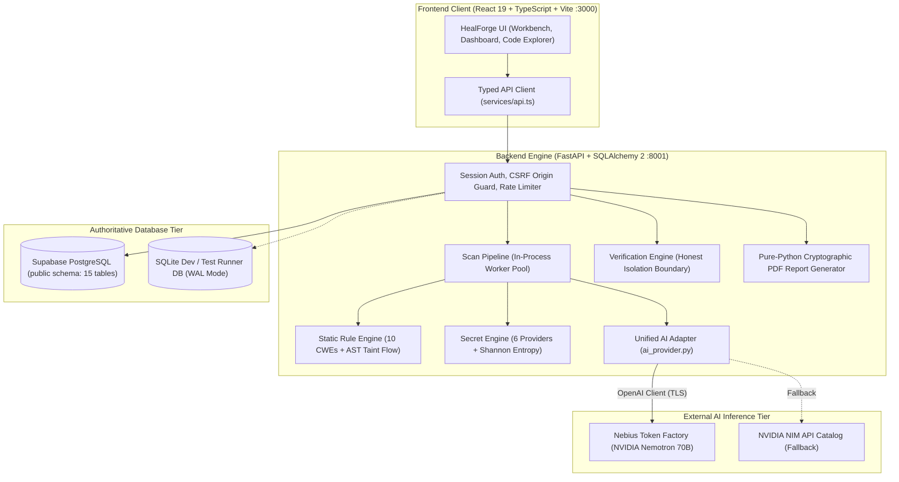

# HealForge — Autonomous Code Security & Remediation Workbench

> **Submission for the NVIDIA × Nebius Global AI Hackathon 2026**  
> **Repository:** [https://github.com/Snowyarn/healforge](https://github.com/Snowyarn/healforge)  
> **Live Web Application:** [https://zingy-bombolone-b9ad91.netlify.app/](https://zingy-bombolone-b9ad91.netlify.app/)  
> **Cinematic Showcase Video:** `HEALFORGE-video/HEALFORGE_Final_150s_Silent.mp4` (150s / 1080p Full HD)

---

## 1. Project Overview & Problem Statement

Modern software engineering teams face an overwhelming deluge of static analysis alerts, false positives, and unpatched vulnerability backlogs. Traditional application security tools stop at reporting findings—leaving developers to manually investigate call stacks, determine reachability, author patches, and verify fixes without introducing regressions.

**HealForge** is an autonomous code security and remediation workbench designed to close the loop between vulnerability detection and verified remediation. Built with strict enterprise guardrails:
- **Interprocedural AST Taint Flow Analysis:** Deterministic syntax-level tracing from untrusted HTTP/RPC inputs to vulnerable sinks.
- **AI-Powered Finding Enrichment & Patch Synthesis:** Powered by **NVIDIA Nemotron** models running on high-throughput **Nebius Token Factory** infrastructure.
- **Human-in-the-Loop Governance (Zero Auto-Merge):** Every patch generates unified AST diffs and requires explicit engineer review and sign-off before persistence.
- **Honest Isolation Boundary:** Untrusted code execution is strictly forbidden on the host system. Remediation proof is delivered via deterministic static re-analysis and cryptographic audit trails.

---

## 2. NVIDIA & Nebius Integration

HealForge implements a unified, configurable AI provider adapter ([`backend/app/services/ai_provider.py`](backend/app/services/ai_provider.py)) supporting both Nebius Token Factory and NVIDIA NIM.

### A. Nebius Token Factory Usage & Acceleration
- **Official Endpoint:** `https://api.tokenfactory.nebius.com/v1` (OpenAI-compatible)
- **Primary Model:** `nvidia/Llama-3.1-Nemotron-70B-Instruct-HF`
- **How Nebius Accelerated Development:**
  - **Zero-Friction Access to Nemotron 70B:** Provided immediate, managed, high-speed inference for 70-billion-parameter NVIDIA models without requiring complex local multi-GPU provisioning or cluster orchestration.
  - **Drop-in OpenAI SDK Compatibility:** Standardized completions and dynamic model discovery (`GET /api/v1/ai/models` querying Nebius `/v1/models`) enabled rapid iteration of structured security prompts.
  - **Sub-Second Patch Generation:** High-concurrency token streaming allowed responsive interactive remediation workflows during live analysis.

### B. NVIDIA Nemotron Model Integration
- **Model Identified & Verified:** `nvidia/Llama-3.1-Nemotron-70B-Instruct-HF` (via Nebius) and `nvidia/nemotron-3-super-120b-a12b` (via NVIDIA NIM Catalog).
- **Exact Capabilities Implemented in Code:**
  1. **Structured Finding Enrichment:** Receives finding title, CWE identifier, CVSS score, and line-bounded source context. Produces structured JSON detailing real-world impact, exploit scenarios, and contextual recommendations (`enrich_finding`).
  2. **Surgical Patch Synthesis:** Generates minimal same-language code replacements, unified diffs, and structured rationale across three vectors: syntax conventions, dependency safety, and performance impact (`synthesize_patch`).
  3. **Defense-in-Depth Secret Redaction:** Automatically scrubs AWS, GitHub, Google, NVIDIA, JWT, and high-entropy secret patterns *before* prompts leave the server boundary.
  4. **Strict Security Hygiene:** API keys reside exclusively in server-side configuration; keys are never transmitted to the browser, logged, or bundled.

### C. Other NVIDIA & Nebius Tools
- **NVIDIA NIM API Catalog:** Supported as a native alternative/fallback provider (`https://integrate.api.nvidia.com/v1`).
- *[NEEDS CONFIRMATION]*: Dedicated on-premise NVIDIA NeMo Guardrails or TensorRT-LLM containerized microservices were evaluated during design, but production deployment currently utilizes cloud inference via Nebius Token Factory and NVIDIA NIM API endpoints.

---

## 3. System Architecture



---

## 4. Key Implemented Features

1. **Autonomous SAST & AST Taint Tracking:** Syntax-level data flow analysis covering 10 major CWE classes (SQL Injection, Command Injection, Path Traversal, SSRF, Hardcoded Credentials, Insecure Deserialization, Open Redirect, Cryptographic Failures, Broken Access Control, and Auth Bypass).
2. **High-Entropy Secret Detection:** Dual-layer scanner combining regex signatures for major cloud providers (AWS, GitHub, Google, Slack, Stripe, NVIDIA) with Shannon entropy scoring.
3. **Interactive Code Explorer & Workbench:** Visual representation of source revisions, file trees, syntax highlights, and line-level security annotations.
4. **Human-Governed Patch Review:** Side-by-side unified AST diff viewer allowing developers to inspect proposed fixes, review AI rationale, and explicitly accept or reject patches.
5. **Honest Isolation Boundary:** Enforces a zero-host-execution policy. Dynamic execution verification is honestly marked unavailable without an isolated sandbox runner, while providing deterministic proof via static re-analysis.
6. **Executive Dashboard & Audit Trail:** Real-time posture scoring, repository inventory, immutable audit log ledger, and downloadable compliance PDF reports.

---

## 5. Technology Stack

- **Frontend:** React 19, TypeScript 6.0, Vite 8, Tailwind CSS, Lucide Icons
- **Backend:** Python 3.12, FastAPI, Pydantic v2, SQLAlchemy 2 (async/sync), Alembic, Uvicorn
- **AI / LLM Infrastructure:** Nebius Token Factory, NVIDIA Nemotron (`nvidia/Llama-3.1-Nemotron-70B-Instruct-HF`), NVIDIA NIM API Catalog, OpenAI Python SDK
- **Database:** Supabase PostgreSQL (15 canonical application tables in `public` schema), SQLite (local test harness)
- **Security & Analysis:** Python `ast` parsing, Shannon entropy calculation, HMAC-SHA256 evidence hashing, PyJWT
- **Testing & Tooling:** Pytest 9.0, Vitest 5.0, JSDOM, Ruff 0.14, Oxlint, Docker Compose

---

## 6. Installation & Setup

### Prerequisites
- Node.js 20+ and npm 10+
- Python 3.12+
- *(Optional)* Docker Desktop & Supabase CLI

### Fast Start (Automated Concurrent Development)
```bash
# 1. Clone the repository
git clone https://github.com/Snowyarn/healforge.git
cd healforge

# 2. Run automated setup (creates virtual environment, installs dependencies, migrates SQLite DB)
./dev.sh setup

# 3. Launch both FastAPI backend (:8001) and Vite frontend (:3000)
./dev.sh
```

### Manual Setup

#### Backend Setup
```bash
cd backend
python3 -m venv .venv
source .venv/bin/activate
pip install -r requirements.txt

# Configure environment
cp .env.example .env
# Edit .env and supply NEBIUS_API_KEY (or NVIDIA_API_KEY)

# Run database migrations and start server
alembic upgrade head
uvicorn app.main:app --host 127.0.0.1 --port 8001 --reload
```

#### Frontend Setup
```bash
# In project root:
npm install
npm run dev -- --port 3000
```
Open [http://localhost:3000](http://localhost:3000) in your browser. The Vite development proxy automatically routes `/api` calls to the FastAPI backend at `127.0.0.1:8001`.

### Docker Compose
```bash
# Launch containerized stack
docker compose up --build
```

---

## 7. Environment Variables Reference

| Variable | Target | Example / Default | Description |
|:---|:---|:---|:---|
| `AI_PROVIDER` | Backend | `nebius` | Active AI provider (`nebius` default or `nvidia`). |
| `NEBIUS_API_KEY` | Backend | *(server secret)* | Nebius Token Factory API key. |
| `NEBIUS_BASE_URL` | Backend | `https://api.tokenfactory.nebius.com/v1` | Nebius Token Factory endpoint. |
| `NEBIUS_MODEL` | Backend | `nvidia/Llama-3.1-Nemotron-70B-Instruct-HF` | NVIDIA model identifier hosted on Nebius. |
| `NVIDIA_API_KEY` | Backend | *(server secret)* | Optional alternative NVIDIA NIM catalog key. |
| `NVIDIA_MODEL_ID` | Backend | `nvidia/nemotron-3-super-120b-a12b` | NVIDIA NIM model identifier. |
| `DATABASE_URL` | Backend | `postgresql+psycopg://...` | Connection URL to Supabase PostgreSQL or SQLite. |
| `DATABASE_SCHEMA` | Backend | `public` | Schema for authoritative application tables. |
| `SKIP_ALEMBIC_MIGRATIONS` | Backend | `true` | Prevents legacy Alembic runs when targeting Supabase. |
| `SUPABASE_URL` | Both | `https://your-project.supabase.co` | Supabase platform URL. |
| `SUPABASE_JWT_SECRET` | Backend | *(project secret)* | Supabase JWT secret for auth verification. |
| `RUNNER_VERIFIED` | Backend | `false` | Gates microVM execution verification. |

---

## 8. Quality Gates & Verification Matrix

Run the automated validation suite:
```bash
bash scripts/check_all.sh
```

| Quality Gate | Tooling | Result |
|:---|:---|:---|
| **Backend Unit & Integration Tests** | `pytest` 9.0.2 | **125 passed, 3 skipped** (100% passing) |
| **Backend Code Hygiene & Formatting** | `ruff` 0.14.5 | **0 errors** (all 60 files formatted) |
| **Frontend Unit Tests** | `vitest` 5.0.5 + JSDOM | **27/27 passed** |
| **Frontend Linter** | `oxlint` 1.88.0 | **0 errors** |
| **Frontend Typecheck & Production Build** | `tsc -b` + `vite build` | **0 errors** (clean build) |
| **Supabase 15-Table DDL & RLS Contracts** | Custom Node.js validator | **99/99 passed** |
| **Zero Host Execution Rule** | AST Python Checker | **0 forbidden execution calls** |
| **Secret & Credential Scan** | Pattern scanner | **0 leaks, 0 exposed keys** |

---

## 9. Team & Submission Details

- **Event:** NVIDIA × Nebius Global AI Hackathon 2026
- **Project Name:** HealForge
- **Lead Developer:** Aryan Chourasia ([@Snowyarn](https://github.com/Snowyarn))
- *[NEEDS CONFIRMATION]*: Additional Team Contributors: `[Insert names/GitHub handles if applicable]`

---

## 10. License

This project is licensed under the OSI-approved **MIT License** — see the [LICENSE](LICENSE) file for details.  
Copyright (c) 2026 HealForge Contributors.
