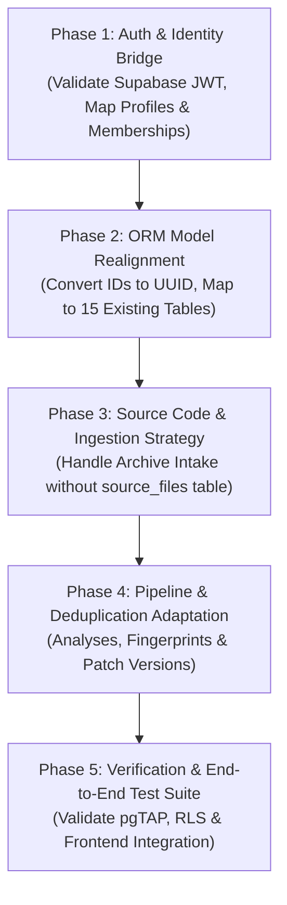

# HealForge — Supabase & FastAPI Backend Compatibility Audit

- **Document Version:** 1.0.0
- **Audit Date:** October 29, 2026
- **Auditor:** Senior Backend Infrastructure Engineer
- **Status:** READ-ONLY COMPATIBILITY AUDIT (Awaiting Architectural Approval)
**Target Environments:**
- **Authoritative Database Source:** Hosted Supabase PostgreSQL (`healforge-dev` / reference `tddznmwvsfuzntmiumof`), Schema: `public`
- **Application Backend:** FastAPI (Python 3.12+), SQLAlchemy 2, Alembic, Pydantic v2
- **Application Frontend:** React 19, TypeScript, Vite, Tailwind CSS

---

## 1. Executive Summary

HealForge has finalized its authoritative data layer: **the existing deployed Supabase PostgreSQL database is the single source of truth**. All existing database schemas, relationships, version-controlled migrations (`supabase/migrations/`), triggers, functions, and 28 Row Level Security (RLS) policies must be preserved without modification.

The incoming FastAPI backend must adapt directly to this Supabase database. **No secondary database schema (such as `healforge_backend`) and no alternate database tables may be created.**

### Core Audit Verdict

The incoming FastAPI backend and the deployed Supabase database represent two fundamentally different architectural paradigms:

```
┌───────────────────────────────────────────────┐        ┌───────────────────────────────────────────────┐
│           FastAPI Backend (Rohit)             │        │          Supabase PostgreSQL (Target)         │
├───────────────────────────────────────────────┤        ├───────────────────────────────────────────────┤
│ • 24 Application Tables                      │        │ • 15 Application Tables                       │
│ • String IDs with prefixes (usr_, fnd_, pat_) │        │ • RFC 4122 UUIDs (gen_random_uuid())          │
│ • Custom SQLite / PostgreSQL table `users`    │        │ • Managed Supabase Auth schema `auth.users`   │
│ • State-stored cookie sessions (auth_sessions)│        │ • Stateless JWT Bearer tokens (auth.uid())    │
│ • Raw source files stored in DB (source_files)│        │ • External VCS / Object Storage references    │
│ • Loose foreign keys & single-column indexes  │        │ • Compound multi-tenant FKs & RLS constraints │
│ • Alembic migration chain                     │        │ • Supabase CLI SQL versioned migrations       │
│ • Monolithic finding record per scan          │        │ • Canonical findings + occurrence junction    │
└───────────────────────────────────────────────┘        └───────────────────────────────────────────────┘
```

Adapting the FastAPI backend to use the deployed Supabase schema directly requires **a deep refactoring of the backend ORM models, identity & authentication layer, ingestion pipeline, and repository layer**. However, the functional capabilities of both codebases map to the same core product workflow (scanning code, detecting security defects, generating patches with LLMs, and recording verification & audit events).

This report delivers a comprehensive table-by-table mapping, categorizes all structural and authorization incompatibilities, details file-by-file changes required across the backend, and outlines the safest phased integration sequence.

---

## 2. Existing Supabase Database Structure

The deployed Supabase PostgreSQL instance implements a 15-table multi-tenant architecture designed specifically for enterprise autonomous security workflows.

### 2.1 Extensions & Custom Data Types

#### Extensions
- `uuid-ossp` & `pgcrypto`: Installed in the database for cryptographic hashing (`digest()`, `hmac()`) and UUID generation (`gen_random_uuid()`).

#### Custom PostgreSQL Enums (22 types)
1. `public.workspace_role`: `'owner'`, `'admin'`, `'security_engineer'`, `'developer'`, `'viewer'`
2. `public.membership_status`: `'active'`, `'invited'`, `'suspended'`
3. `public.repository_provider`: `'github'`, `'gitlab'`, `'bitbucket'`, `'other'`
4. `public.connection_status`: `'connected'`, `'disconnected'`, `'syncing'`, `'error'`
5. `public.integration_provider`: `'github'`, `'gitlab'`, `'bitbucket'`, `'anthropic'`, `'openai'`, `'gemini'`, `'gvisor_sandbox'`, `'slack'`, `'jira'`, `'custom_webhook'`
6. `public.integration_status`: `'active'`, `'inactive'`, `'revoked'`, `'error'`
7. `public.scan_trigger`: `'manual'`, `'ci_webhook'`, `'cron'`, `'pr_hook'`
8. `public.scan_type`: `'sast'`, `'sbom'`, `'secrets'`, `'container_audit'`, `'composite'`
9. `public.scan_status`: `'queued'`, `'running'`, `'completed'`, `'failed'`, `'cancelled'`
10. `public.vulnerability_severity`: `'critical'`, `'high'`, `'medium'`, `'low'`
11. `public.finding_confidence`: `'high'`, `'medium'`, `'low'`
12. `public.reachability_status`: `'reachable'`, `'unreachable'`, `'unknown'`
13. `public.finding_status`: `'open'`, `'in_progress'`, `'patch_generated'`, `'verified_fixed'`, `'false_positive'`, `'ignored'`, `'closed'`
14. `public.patch_status`: `'generating'`, `'ready_for_review'`, `'under_review'`, `'approved'`, `'rejected'`, `'changes_requested'`, `'applied'`, `'superseded'`
15. `public.review_decision`: `'approved'`, `'rejected'`, `'changes_requested'`
16. `public.sandbox_status`: `'queued'`, `'initializing'`, `'running'`, `'passed'`, `'failed'`, `'timeout'`, `'cancelled'`
17. `public.network_policy_type`: `'deny_all'`, `'isolated_local_only'`, `'allow_package_registry'`
18. `public.verification_check_type`: `'build_verification'`, `'regression_test'`, `'vulnerability_replay'`, `'post_patch_sast'`
19. `public.verification_check_status`: `'pending'`, `'running'`, `'passed'`, `'failed'`, `'skipped'`
20. `public.audit_category`: `'auth'`, `'profile'`, `'security'`, `'api'`, `'billing'`, `'team'`, `'privacy'`, `'repository'`, `'analysis'`, `'patch'`, `'verification'`
21. `public.audit_status`: `'success'`, `'warning'`, `'failed'`
22. `public.report_type`: `'vulnerability_summary'`, `'project_assessment'`, `'scan_audit'`, `'sandbox_attestation'`, `'custom'`
23. `public.report_format`: `'PDF'`, `'Markdown'`, `'JSON'`, `'CSV'`

### 2.2 Table Definitions (15 Application Tables in `public`)

| # | Table Name | Primary Key | Key Foreign Keys | Purpose |
|---|---|---|---|---|
| 1 | `profiles` | `UUID` | `id -> auth.users(id)` | User profile metadata (never holds passwords). |
| 2 | `workspaces` | `UUID` | `owner_id -> auth.users(id)` | Multi-tenant boundary grouping all assets. |
| 3 | `workspace_members` | `UUID` | `workspace_id -> workspaces(id)`, `user_id -> auth.users(id)` | RBAC membership table. |
| 4 | `repositories` | `UUID` | `workspace_id -> workspaces(id)` | Codebases monitored for security defects. |
| 5 | `integration_connections` | `UUID` | `workspace_id -> workspaces(id)` | Third-party integrations (stores `secret_ref`, never plaintext secrets). |
| 6 | `analyses` | `UUID` | `(repository_id, workspace_id) -> repositories(id, workspace_id)` | Scans and analysis runs. |
| 7 | `findings` | `UUID` | `(repository_id, workspace_id) -> repositories(id, workspace_id)` | Canonical vulnerabilities deduplicated by fingerprint. |
| 8 | `analysis_findings` | `UUID` | `analysis_id -> analyses(id)`, `finding_id -> findings(id)` | Historical occurrence junction table. |
| 9 | `patches` | `UUID` | `(finding_id, workspace_id) -> findings(id, workspace_id)` | Autonomous remediation parent record. |
| 10 | `patch_versions` | `UUID` | `patch_id -> patches(id)` | Versioned unified diffs (strictly immutable). |
| 11 | `patch_reviews` | `UUID` | `patch_version_id -> patch_versions(id)`, `reviewer_id -> auth.users(id)` | Human sign-off decisions and review feedback. |
| 12 | `sandbox_runs` | `UUID` | `(repository_id, workspace_id) -> repositories(id, workspace_id)`, `patch_version_id -> patch_versions(id)` | Isolated gVisor microVM test execution runs. |
| 13 | `verification_checks` | `UUID` | `sandbox_run_id -> sandbox_runs(id)` | Sub-stages of verification (replays, unit tests, SAST). |
| 14 | `audit_logs` | `UUID` | `workspace_id -> workspaces(id)`, `actor_id -> auth.users(id)` | Tamper-evident, immutable audit trail. |
| 15 | `saved_reports` | `UUID` | `workspace_id -> workspaces(id)`, `created_by -> auth.users(id)` | Persisted executive summaries and compliance exports. |

### 2.3 Relational & Immutability Constraints

1. **Multi-Tenant Compound Foreign Keys:**
   - Child tables maintain compound foreign keys enforcing workspace containment:
     - `analyses`: `(repository_id, workspace_id) REFERENCES repositories(id, workspace_id)`
     - `findings`: `(repository_id, workspace_id) REFERENCES repositories(id, workspace_id)`
     - `patches`: `(finding_id, workspace_id) REFERENCES findings(id, workspace_id)`
     - `patches`: `(repository_id, workspace_id) REFERENCES repositories(id, workspace_id)`
     - `sandbox_runs`: `(repository_id, workspace_id) REFERENCES repositories(id, workspace_id)`
   - An entity can *never* cross workspace boundaries even if an invalid foreign key is supplied.
2. **Deduplication Fingerprinting:**
   - `findings` contains `CONSTRAINT uq_finding_fingerprint UNIQUE (repository_id, fingerprint)`.
   - Fingerprint is generated via SHA-256 of `repo_id:rule_id:file_path:sink_snippet`.
3. **Database-Enforced Immutability Triggers:**
   - `block_audit_log_updates`: Rejects any `UPDATE` or `DELETE` statement executed on `public.audit_logs`.
   - `block_patch_version_alteration`: Rejects any `UPDATE` statement that alters `diff_content`, `content_hash`, or `version_number` in `public.patch_versions`.
   - `enforce_role_escalation_rules`: Triggers on `public.workspace_members` to prevent members from escalating their own role, removing the last active owner, or assigning roles higher than their own.

### 2.4 Row Level Security (RLS) Policies

All 15 tables in `public` have Row Level Security enabled (`ALTER TABLE ... ENABLE ROW LEVEL SECURITY`). There are 28 granular policies checking workspace membership through helper functions:
- `public.is_workspace_member(target_workspace_id UUID)`
- `public.has_workspace_role(target_workspace_id UUID, required_role workspace_role)`
- `public.get_user_workspace_role(target_workspace_id UUID, check_user_id UUID)`

All helper functions use `auth.uid()` from the Supabase JWT context to determine identity and role.

---

## 3. FastAPI Backend Database Structure

Rohit's backend uses SQLAlchemy 2 with 24 declarative ORM models mapped across two domain modules:
- `backend/app/models/account.py` (10 tables)
- `backend/app/models/workbench.py` (14 tables)

### 3.1 ID Generation & Data Types
- **Primary Keys:** String-based IDs formatted as `{prefix}_{uuid4_hex[:16]}` (e.g., `usr_9a4f210b3c8e71ad`, `fnd_8a39b2...`, `ws_...`, `pat_...`).
- **Timestamps:** Python `datetime` stored as `DateTime(timezone=True)`.
- **JSON Fields:** Generic SQLAlchemy `JSON` types without schema validation.

### 3.2 Backend Table Summary (24 Models)

| Model Name | Table Name | Domain | Primary Key Format |
|---|---|---|---|
| `UserAccount` | `users` | Account | `usr_<16-hex>` |
| `UserProfile` | `user_profiles` | Account | `prf_<16-hex>` |
| `UserPreferences` | `user_preferences` | Account | `prc_<16-hex>` |
| `AuthSession` | `auth_sessions` | Account | `ses_<16-hex>` |
| `ApiKey` | `api_keys` | Account | `key_<16-hex>` |
| `WebhookEndpoint` | `webhooks` | Account | `whk_<16-hex>` |
| `TeamMember` | `team_members` | Account | `mem_<16-hex>` |
| `IntegrationConfig` | `integrations` | Account | `itg_<16-hex>` |
| `IdempotencyRecord` | `idempotency_records` | Account | `idm_<16-hex>` |
| `Notification` | `notifications` | Account | `ntf_<16-hex>` |
| `Workspace` | `workspaces` | Workbench | `ws_<16-hex>` |
| `Project` | `projects` | Workbench | `proj_<16-hex>` |
| `SourceRevision` | `source_revisions` | Workbench | `rev_<16-hex>` |
| `SourceFile` | `source_files` | Workbench | `sfl_<16-hex>` |
| `ScanJob` | `scan_jobs` | Workbench | `scan_<16-hex>` |
| `ScanLog` | `scan_logs` | Workbench | `INTEGER` autoincrement |
| `Finding` | `findings` | Workbench | `fnd_<16-hex>` |
| `PatchProposal` | `patch_proposals` | Workbench | `pat_<16-hex>` |
| `ReviewEvent` | `review_events` | Workbench | `rev_<16-hex>` |
| `VerificationRun` | `verification_runs` | Workbench | `vrun_<16-hex>` |
| `AgentExecution` | `agent_executions` | Workbench | `aex_<16-hex>` |
| `Report` | `reports` | Workbench | `rpt_<16-hex>` |
| `AuditEvent` | `audit_events` | Workbench | `aud_<16-hex>` |
| `BugReport` | `bug_reports` | Workbench | `bug_<16-hex>` |

---

## 4. Table-by-Table Comparison Matrix

The table below maps the 15 Supabase target tables against Rohit's 24 backend tables, indicating the migration status, structural differences, and resolution requirements.

| # | Supabase Table (`public`) | Backend Table (`app/models`) | Mapping Status | Key Discrepancies & Resolution |
|---|---|---|:---:|---|
| 1 | `profiles` | `users` + `user_profiles` | **Needs Mapping** | Supabase `profiles.id` is a `UUID` referencing `auth.users(id)`. Backend splits user data into `users` (password, role, MFA) and `user_profiles` (name, avatar, expertise). Backend must eliminate `users` and map directly to `profiles` using Supabase Auth UUID. |
| 2 | `workspaces` | `workspaces` | **Needs Mapping** | Supabase has `UUID id`, `slug TEXT UNIQUE`, `owner_id UUID REFERENCES auth.users`, `tier`, and `settings JSONB`. Backend has `String(48) id`, `name`, `owner_user_id`, `engine_paused`. Must adapt backend model to match Supabase schema columns and UUID keys. |
| 3 | `workspace_members` | `team_members` | **Needs Mapping** | Supabase has `UUID id`, `workspace_id UUID`, `user_id UUID REFERENCES auth.users`, `role workspace_role enum`, `status membership_status enum`. Backend has `team_members` with `String` IDs, string status, invite token hash, and email. Must map backend team operations to `workspace_members`. |
| 4 | `repositories` | `projects` | **Needs Mapping** | Supabase uses `repositories` (`UUID id`, `provider repository_provider`, `owner_name`, `name`, `url`, `default_branch`, `runtime`, `security_score`, `open_vuln_count`). Backend uses `projects` (`String id`, `provider`, `name`, `primary_branch`, `runtime`). Must map `projects` router/services to query `repositories`. |
| 5 | `integration_connections`| `integrations` | **Needs Mapping** | Supabase uses `integration_connections` (`UUID id`, `provider integration_provider enum`, `secret_ref TEXT` for KMS/Vault, `metadata JSONB`). Backend uses `integrations` (`String id`, `provider String`, `config JSON`). Must adapt backend model. |
| 6 | `analyses` | `scan_jobs` | **Needs Mapping** | Supabase uses `analyses` (`UUID id`, `repository_id UUID`, `branch`, `commit_sha`, `scan_type enum`, `status scan_status enum`, `duration_seconds`, `logs TEXT[]`). Backend uses `scan_jobs` with child `scan_logs` table. Must adapt backend scan pipeline to insert and update `analyses`. |
| 7 | `findings` | `findings` | **Needs Mapping** | Supabase findings require `UUID id`, `repository_id UUID`, `fingerprint TEXT UNIQUE`, `severity vulnerability_severity enum`, `cvss_score NUMERIC(3,1)`. Backend uses `display_id` (`HF-0001`), `fnd_...` string ID, and float CVSS. Must adapt backend `Finding` model to Supabase schema. |
| 8 | `analysis_findings` | *(No backend table)* | **Missing in Backend**| Supabase decouples canonical findings from scan occurrences via `analysis_findings`. Rohit's backend attaches `scan_id` directly to each finding. Backend pipeline must insert junction rows into `analysis_findings` upon scan completion. |
| 9 | `patches` | `patch_proposals` | **Needs Mapping** | Supabase `patches` has `UUID id`, `finding_id UUID`, `repository_id UUID`, `model_provider`, `model_name`, `current_version_number`. Backend uses `patch_proposals` with `diff` embedded directly in the row. Diff must be extracted to `patch_versions`. |
| 10 | `patch_versions` | *(Embedded in `patch_proposals`)*| **Missing in Backend**| Supabase enforces immutable versioning in `patch_versions` (`patch_id`, `version_number`, `diff_content`, `content_hash`). Backend stores `diff` and `version` on `patch_proposals`. Backend must insert version records into `patch_versions`. |
| 11 | `patch_reviews` | `review_events` | **Needs Mapping** | Supabase links reviews to `patch_version_id` with `reviewer_id UUID REFERENCES auth.users`, `decision review_decision enum`. Backend links `review_events` to `patch_proposals.id` with string user ID. Must adapt to version-linked reviews. |
| 12 | `sandbox_runs` | `verification_runs` | **Needs Mapping** | Supabase `sandbox_runs` links to `patch_version_id` with `execution_environment`, `isolation_config JSONB`, `network_policy enum`, `attestation_hash`. Backend has `mode` (`execution`/`static_reanalysis`). Must map verification service to `sandbox_runs`. |
| 13 | `verification_checks` | *(Embedded in `results` JSON)*| **Missing in Backend**| Supabase breaks down sandbox runs into discrete check stages (`build_verification`, `vulnerability_replay`, etc.). Backend stores `results` as a JSON blob. Backend should populate `verification_checks`. |
| 14 | `audit_logs` | `audit_events` | **Needs Mapping** | Supabase uses `audit_logs` (`actor_id UUID REFERENCES auth.users`, `category audit_category enum`, `status audit_status enum`, immutable trigger). Backend uses `audit_events` with string categories and IDs. Must adapt audit service. |
| 15 | `saved_reports` | `reports` | **Needs Mapping** | Supabase uses `saved_reports` (`report_type report_type enum`, `format report_format enum`, `created_by UUID`). Backend uses `reports` with string types. Must adapt report generation service. |

---

### 4.1 Backend Tables with No Counterpart in Supabase

The following 9 tables exist in Rohit's backend but **do not exist** in the Supabase schema:

1. **`source_files` & `source_revisions`:**
   - *Backend Purpose:* Stores full source code files (up to 256 KB each) and revision metadata directly in PostgreSQL text columns.
   - *Supabase Architecture:* Code is not stored in SQL tables. Repositories point to Git providers (`url`) or are expected to reside in object storage (Supabase Storage bucket `code-archives`).
   - *Resolution:* Backend must either cache source files locally in an ephemeral scratch volume/storage bucket, or store zip archives in Supabase Storage, rather than creating database tables.
2. **`scan_logs`:**
   - *Backend Purpose:* Child table containing line-by-line log events for scan executions.
   - *Supabase Architecture:* Supabase `analyses` stores logs as a native PostgreSQL array: `logs TEXT[]`.
   - *Resolution:* Backend can append log lines directly to the `analyses.logs` array or aggregate them upon scan completion.
3. **`agent_executions`:**
   - *Backend Purpose:* Tracks multi-stage agent activity steps (`#EX-0001`) with traces and artifacts.
   - *Supabase Architecture:* Not modeled in core relational DDL (intended as ephemeral execution trace or stored within `analyses.logs` / `audit_logs.metadata`).
   - *Resolution:* Can be recorded within `audit_logs` or serialized into JSON in `analyses.logs`.
4. **`bug_reports`:**
   - *Backend Purpose:* Issue tracker for workbench bug reports.
   - *Supabase Architecture:* Not present in core 15 tables.
   - *Resolution:* Can be recorded via `audit_logs` (`category = 'security'`, `entity_type = 'bug_report'`) or external issue tracker.
5. **`user_preferences`:**
   - *Backend Purpose:* User-level UI theme and notification toggle state.
   - *Supabase Architecture:* Stored in `workspaces.settings JSONB` or Supabase Auth `user_metadata`.
   - *Resolution:* Store in `auth.users.raw_user_meta_data` or retrieve from workspace settings.
6. **`auth_sessions` & `api_keys`:**
   - *Backend Purpose:* Custom server-side session management and API key storage.
   - *Supabase Architecture:* Supabase handles sessions natively through GoTrue / Supabase Auth JWTs. API keys and service tokens are handled via Supabase Auth / Vault.
   - *Resolution:* Backend must validate incoming Supabase JWTs instead of querying a local `auth_sessions` table.
7. **`webhooks`:**
   - *Backend Purpose:* Outgoing webhook endpoints.
   - *Supabase Architecture:* Managed through `integration_connections` (`provider = 'custom_webhook'`).
   - *Resolution:* Map webhook configurations into `integration_connections`.
8. **`idempotency_records`:**
   - *Backend Purpose:* Deduping HTTP retries with request hashes.
   - *Supabase Architecture:* Not present in relational tables.
   - *Resolution:* Can be managed in Redis or an in-memory TTL cache (e.g. `cachetools`) within FastAPI.
9. **`notifications`:**
   - *Backend Purpose:* User notification queue.
   - *Supabase Architecture:* Handled via Supabase Realtime broadcast channels or client notifications.

---

## 5. Compatibility & Incompatibility Deep-Dive

### 5.1 Primary Key & ID Format Incompatibility (UUID vs String)

- **The Problem:**
  - Supabase tables strictly enforce RFC 4122 `UUID` columns generated via `gen_random_uuid()`.
  - Rohit's backend models define all primary and foreign keys as `String(48)` with prefix IDs (e.g. `new_id("fnd")` -> `fnd_8a39b2c14e051d9a`).
  - Attempting to insert a string like `fnd_8a39...` into a PostgreSQL `UUID` column triggers error `22P02: invalid input syntax for type uuid`.
- **Resolution:**
  - Update all SQLAlchemy models to use `UUID(as_uuid=True)` (or PostgreSQL-native `pg.UUID`) with `default=uuid.uuid4`.
  - Keep human-readable identifiers (`display_id` like `HF-0001` or `CVE-2024-41110`) in auxiliary text columns (`findings.rule_id`, `findings.cve_id`, or `repositories.name`).

### 5.2 Authentication & User Identity Conflict

- **The Problem:**
  - Rohit's backend contains a custom `users` table storing `password_hash`, `mfa_secret`, and custom sessions in `auth_sessions`.
  - The Supabase database stores users in `auth.users`, and `public.profiles` references `auth.users(id)` via `ON DELETE CASCADE`.
  - Multiple Supabase tables enforce foreign keys pointing directly to `auth.users(id)`:
    - `profiles.id -> auth.users(id)`
    - `workspaces.owner_id -> auth.users(id)`
    - `workspace_members.user_id -> auth.users(id)`
    - `analyses.created_by -> auth.users(id)`
    - `patches.created_by -> auth.users(id)`
    - `patch_reviews.reviewer_id -> auth.users(id)`
    - `audit_logs.actor_id -> auth.users(id)`
    - `saved_reports.created_by -> auth.users(id)`
  - If the FastAPI backend generates arbitrary string IDs or custom user rows, any insert into these tables fails immediately with `23503: foreign_key_violation`.
- **Resolution:**
  - FastAPI must retire its internal `users` table and password verification logic.
  - The backend must accept the Supabase Auth JWT (`Authorization: Bearer <token>`) passed from the React frontend or extracted from the Supabase auth cookie.
  - FastAPI verifies the JWT using the Supabase JWT secret (or JWKS public keys) to resolve `user_id` (a valid UUID matching `auth.users.id`).

### 5.3 Row Level Security (RLS) & Database Connection Privileges

- **The Problem:**
  - Supabase enables RLS on all 15 tables. RLS policies check `auth.uid()`, which is evaluated from PostgreSQL transaction settings (`request.jwt.claims`).
  - When FastAPI connects directly via SQLAlchemy using a standard connection string:
    - If connecting as `postgres` or with `service_role`, RLS is **bypassed completely**. This is acceptable for background workers (scanners, patch generators), but bypasses tenant isolation for user-facing API routes if not enforced in application code.
    - If connecting as an unprivileged user, `auth.uid()` evaluates to `NULL`, causing **all SELECT, INSERT, and UPDATE queries to return zero rows or fail**.
- **Resolution:**
  - The backend should use the dual-client pattern described in `docs/database/BACKEND_HANDOFF.md`:
    1. **For User API Endpoints:** Set PostgreSQL session claims before executing queries:
       ```sql
       SET LOCAL request.jwt.claims = '{"sub": "<user_uuid>", "role": "authenticated"}';
       SET LOCAL role = 'authenticated';
       ```
       Or explicitly enforce `workspace_id` filtering in every SQLAlchemy query using the verified `workspace_id` from the user's membership.
    2. **For Background Workers:** Connect using the elevated connection string (`service_role` or `postgres` user) to record scan outcomes and patches across tenants.

### 5.4 Finding Deduplication & Fingerprint Architecture

- **The Problem:**
  - In Rohit's backend, every scan execution creates new rows in `findings`. Running the same scan twice duplicates all findings.
  - Supabase enforces canonical deduplication via:
    ```sql
    CONSTRAINT uq_finding_fingerprint UNIQUE (repository_id, fingerprint)
    ```
    Where `fingerprint` is a SHA-256 hash of `(repo_id, rule_id, affected_file, sink_snippet)`.
  - Attempting to insert a duplicate finding without `ON CONFLICT` raises `23505: unique_violation`.
- **Resolution:**
  - When the scanner detects a vulnerability, compute the fingerprint using `public.generate_finding_fingerprint` (or Python equivalent SHA-256).
  - Execute an `UPSERT` on `public.findings`:
    - If new: Insert finding record.
    - If existing: Update `latest_analysis_id` and timestamp.
  - Insert a record into `public.analysis_findings` linking the specific `analysis_id` to the canonical `finding_id`.

### 5.5 Patch Storage & Immutability Trigger

- **The Problem:**
  - Rohit's backend stores the unified diff directly on `patch_proposals.diff`.
  - Supabase separates patch metadata (`patches`) from immutable versions (`patch_versions`).
  - Trigger `block_patch_version_alteration` aborts any SQL `UPDATE` statement that modifies `diff_content`, `content_hash`, or `version_number`.
- **Resolution:**
  - When generating a patch, FastAPI must:
    1. Insert into `public.patches` (title, explanation, model metadata, `current_version_number = 1`).
    2. Insert into `public.patch_versions` (`patch_id`, `version_number = 1`, `diff_content`, `content_hash = sha256(diff_content)`).
  - Any subsequent revision increments `version_number` and creates a *new* row in `patch_versions`.

---

## 6. Required Backend Changes File-by-File

To adapt the FastAPI backend directly to the Supabase database, the following files must be refactored:

### 6.1 Database Connection & Configuration

| File | Changes Required |
|---|---|
| [`backend/app/config.py`](file:///Users/aryanchourasia/Projects/healforge/backend/app/config.py) | • Remove `database_schema: str = "healforge_backend"`.<br>• Add `supabase_url`, `supabase_service_role_key`, and `supabase_jwt_secret`.<br>• Configure `database_url` to point directly to Supabase PostgreSQL (`db.<ref>.supabase.co:5432` or pooler `:6543`). |
| [`backend/app/db.py`](file:///Users/aryanchourasia/Projects/healforge/backend/app/db.py) | • Remove `connect_args["options"] = "-c search_path=healforge_backend"`.<br>• Set default schema to `public`.<br>• Configure connection pooling for PostgreSQL (with SSL `sslmode=require`). |
| [`backend/alembic/env.py`](file:///Users/aryanchourasia/Projects/healforge/backend/alembic/env.py) | • Disable Alembic migrations against the live database (`env.py` must not attempt to create or alter tables, since Supabase CLI manages migrations). |

### 6.2 ORM Models (`backend/app/models/`)

| File | Changes Required |
|---|---|
| [`backend/app/models/base.py`](file:///Users/aryanchourasia/Projects/healforge/backend/app/models/base.py) | • Replace `new_id(prefix)` with native `uuid.uuid4()` returning UUID objects or valid UUID strings. |
| [`backend/app/models/account.py`](file:///Users/aryanchourasia/Projects/healforge/backend/app/models/account.py) | • Deprecate `UserAccount`, `AuthSession`, `ApiKey`, `WebhookEndpoint`, `Notification`, `IdempotencyRecord`.<br>• Replace `UserProfile` with `Profile` mapped to `public.profiles` (`id UUID PRIMARY KEY`, `email`, `full_name`, `avatar_url`, `skills TEXT[]`, `expertise TEXT[]`).<br>• Map `TeamMember` to `public.workspace_members` (`id UUID`, `workspace_id UUID`, `user_id UUID`, `role workspace_role`, `status membership_status`). |
| [`backend/app/models/workbench.py`](file:///Users/aryanchourasia/Projects/healforge/backend/app/models/workbench.py) | • Refactor `Workspace` to match `public.workspaces` (`id UUID`, `name`, `slug`, `owner_id UUID`, `tier`, `settings JSONB`).<br>• Refactor `Project` to `Repository` mapped to `public.repositories` (`id UUID`, `workspace_id UUID`, `provider`, `owner_name`, `name`, `url`, `default_branch`, `runtime`, `security_score`).<br>• Refactor `ScanJob` to `Analysis` mapped to `public.analyses` (`id UUID`, `repository_id UUID`, `branch`, `commit_sha`, `scan_type`, `status`, `logs TEXT[]`).<br>• Refactor `Finding` mapped to `public.findings` (`id UUID`, `repository_id UUID`, `fingerprint`, `cve_id`, `cwe_id`, `severity`, `confidence`, `reachability`, `cvss_score NUMERIC(3,1)`).<br>• Add `AnalysisFinding` mapped to `public.analysis_findings`.<br>• Refactor `PatchProposal` to `Patch` (`public.patches`) and `PatchVersion` (`public.patch_versions`).<br>• Refactor `ReviewEvent` to `PatchReview` (`public.patch_reviews`).<br>• Refactor `VerificationRun` to `SandboxRun` (`public.sandbox_runs`) and `VerificationCheck` (`public.verification_checks`).<br>• Refactor `AuditEvent` to `AuditLog` (`public.audit_logs`).<br>• Refactor `Report` to `SavedReport` (`public.saved_reports`). |

### 6.3 Authentication & Security (`backend/app/security/`)

| File | Changes Required |
|---|---|
| [`backend/app/security/sessions.py`](file:///Users/aryanchourasia/Projects/healforge/backend/app/security/sessions.py) | • Replace cookie token lookup with Supabase JWT validation (`jose` / `PyJWT`).<br>• Extract `sub` as user UUID and verify against `public.profiles`.<br>• Resolve user's active workspace from `public.workspace_members`. |
| [`backend/app/security/rbac.py`](file:///Users/aryanchourasia/Projects/healforge/backend/app/security/rbac.py) | • Align role hierarchy with Supabase `workspace_role` (`owner` > `admin` > `security_engineer` > `developer` > `viewer`). |
| [`backend/app/api/deps.py`](file:///Users/aryanchourasia/Projects/healforge/backend/app/api/deps.py) | • Update `get_ctx` dependency to accept Bearer token from `Authorization` header or Supabase session cookie.<br>• Inject validated user UUID and workspace UUID into request context. |

### 6.4 API Routers & Serializers (`backend/app/api/`)

| File | Changes Required |
|---|---|
| [`backend/app/api/serializers.py`](file:///Users/aryanchourasia/Projects/healforge/backend/app/api/serializers.py) | • Update all DTO builders to consume UUID fields from the refactored models.<br>• Join `patches` with `patch_versions` to reconstruct `diff` and version history.<br>• Query `analysis_findings` when returning scan finding occurrences. |
| [`backend/app/api/routers/projects.py`](file:///Users/aryanchourasia/Projects/healforge/backend/app/api/routers/projects.py) | • Query `public.repositories` instead of `projects`.<br>• Handle archive imports by saving files to local scratch disk / Supabase Storage rather than inserting into SQL `source_files`. |
| [`backend/app/api/routers/scans.py`](file:///Users/aryanchourasia/Projects/healforge/backend/app/api/routers/scans.py) | • Insert into `public.analyses` instead of `scan_jobs`.<br>• Update status values to match `scan_status` enum (`queued`, `running`, `completed`, `failed`). |
| [`backend/app/api/routers/patches.py`](file:///Users/aryanchourasia/Projects/healforge/backend/app/api/routers/patches.py) | • Insert parent row into `patches` and child diff row into `patch_versions`.<br>• Record review decisions in `patch_reviews` with `reviewer_id = ctx.user.id`. |

### 6.5 Business Logic & Services (`backend/app/services/`)

| File | Changes Required |
|---|---|
| [`backend/app/services/scan_pipeline.py`](file:///Users/aryanchourasia/Projects/healforge/backend/app/services/scan_pipeline.py) | • Compute deterministic SHA-256 fingerprint for each detected finding.<br>• Perform UPSERT into `public.findings`.<br>• Insert junction rows into `public.analysis_findings`.<br>• Append progress log messages to `analyses.logs` array instead of inserting `ScanLog` rows. |
| [`backend/app/services/verification.py`](file:///Users/aryanchourasia/Projects/healforge/backend/app/services/verification.py) | • Map verification runs to `public.sandbox_runs` linked to `patch_version_id`.<br>• Populate individual `public.verification_checks` for each check executed. |
| [`backend/app/services/audit.py`](file:///Users/aryanchourasia/Projects/healforge/backend/app/services/audit.py) | • Insert records into `public.audit_logs` using Supabase enums (`audit_category`, `audit_status`). |
| [`backend/app/services/reports.py`](file:///Users/aryanchourasia/Projects/healforge/backend/app/services/reports.py) | • Insert generated reports into `public.saved_reports`. |

---

## 7. Recommended Integration Plan

To transition the FastAPI backend safely from its current isolated model to direct operation on the Supabase database without risking database corruption or downtime, execute the following 5-phase plan:



### Phase 1: Authentication & Identity Bridge
1. Configure `backend/app/config.py` with `SUPABASE_JWT_SECRET` and `SUPABASE_URL`.
2. Implement a JWT verification dependency in `backend/app/security/sessions.py` that parses the Supabase user UUID (`sub`).
3. Query `public.profiles` and `public.workspace_members` using the authenticated UUID.
4. Verify that user identity seamlessly aligns with `auth.users(id)` without maintaining a separate `users` table.

### Phase 2: ORM Model Realignment
1. Update `backend/app/models/base.py` to use UUID primary keys.
2. Refactor `backend/app/models/workbench.py` to define the 15 matching SQLAlchemy models corresponding exactly to the 15 tables in `supabase/migrations/20261027120000_core_schema.sql`.
3. Use PostgreSQL enum types (`Enum(..., name='...')`) matching the existing Supabase enums.
4. Freeze Alembic migrations so it operates in read-only / reflection mode and never issues `CREATE TABLE` or `ALTER TABLE` DDL against Supabase.

### Phase 3: Source Code & Storage Strategy
1. The Supabase schema does not store file contents in SQL tables.
2. Refactor `backend/app/services/upload.py` to extract uploaded project archives into a temporary workspace on disk (`/tmp/healforge/repos/<repo_id>`) or a Supabase Storage bucket (`code-archives`).
3. Point `repositories.url` or metadata to this location so AST scanners can inspect the files without requiring `source_files` table rows.

### Phase 4: Ingestion Pipeline & Patch Versioning Adaptation
1. Update `backend/app/services/scan_pipeline.py`:
   - Write scan records to `public.analyses`.
   - Calculate finding fingerprints and perform PostgreSQL `UPSERT` on `public.findings`.
   - Write detection history to `public.analysis_findings`.
2. Update `backend/app/api/routers/patches.py` and `ai_provider.py`:
   - When Nebius Token Factory synthesizes a patch, create the parent record in `public.patches`.
   - Compute SHA-256 hash of the diff and insert into `public.patch_versions`.
   - Write human review outcomes to `public.patch_reviews`.

### Phase 5: Verification, Audit & Test Validation
1. Map static re-analysis and sandbox execution records to `public.sandbox_runs` and `public.verification_checks`.
2. Map security audit events to `public.audit_logs`.
3. Run the comprehensive test suite:
   - Supabase static validation: `npm run test:db` (99/99 must continue to pass).
   - Backend unit tests updated with mock UUIDs.
   - Live Supabase connection test verifying RLS compliance and trigger integrity.

---

## 8. Conclusion & Sign-Off

This audit confirms that the FastAPI backend can adapt to the existing Supabase PostgreSQL database, but requires **refactoring the backend ORM models, identity layer, and storage strategy** to eliminate the 9 non-existent tables and strictly honor the 15 UUID-based tables and constraints.

- **Status:** Audit complete. All strict restrictions respected: no files modified, no migrations executed, no database connections altered.

Awaiting user approval before proceeding with implementation.
