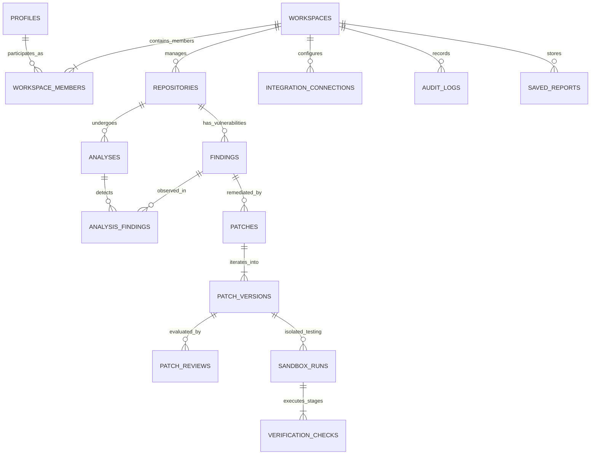

# HealForge Entity-Relationship Diagram (ERD)

This document visualizes the relational architecture of the HealForge PostgreSQL database foundation.

---

## 1. High-Level Entity Relationship Diagram

---

## 2. Detailed Relational Schema Map

```mermaid
erDiagram
    PROFILES {
        uuid id PK
        text email
        text full_name
        text display_name
        text username
        text job_title
        text role_title
        text organization
        text department
        text bio
        text phone
        text location
        text_array expertise
        text_array skills
        timestamptz created_at
        timestamptz updated_at
    }

    WORKSPACES {
        uuid id PK
        text name
        text slug
        uuid owner_id FK
        text tier
        jsonb settings
        timestamptz created_at
        timestamptz updated_at
    }

    WORKSPACE_MEMBERS {
        uuid id PK
        uuid workspace_id FK
        uuid user_id FK
        workspace_role role
        membership_status status
        uuid invited_by FK
        timestamptz created_at
        timestamptz updated_at
    }

    REPOSITORIES {
        uuid id PK
        uuid workspace_id FK
        repository_provider provider
        text external_repo_id
        text owner_name
        text name
        text url
        text default_branch
        text runtime
        integer security_score
        connection_status connection_status
        timestamptz last_scan_at
        integer open_vuln_count
        integer critical_count
        integer high_count
        timestamptz created_at
        timestamptz updated_at
    }

    INTEGRATION_CONNECTIONS {
        uuid id PK
        uuid workspace_id FK
        integration_provider provider
        text name
        integration_status status
        text account_identifier
        text_array scopes
        text secret_ref
        jsonb metadata
        timestamptz last_sync_at
        timestamptz created_at
        timestamptz updated_at
    }

    ANALYSES {
        uuid id PK
        uuid workspace_id FK
        uuid repository_id FK
        text branch
        text commit_sha
        scan_trigger trigger_type
        scan_type scan_type
        scan_status status
        timestamptz started_at
        timestamptz completed_at
        integer duration_seconds
        integer findings_count
        integer critical_count
        integer high_count
        text safe_error_message
        uuid created_by FK
        timestamptz created_at
    }

    FINDINGS {
        uuid id PK
        uuid workspace_id FK
        uuid repository_id FK
        text fingerprint
        text cve_id
        text cwe_id
        text title
        text description
        vulnerability_severity severity
        finding_confidence confidence
        reachability_status reachability
        numeric cvss_score
        text affected_file
        integer start_line
        integer end_line
        text scanner_name
        text rule_id
        uuid first_detected_analysis_id FK
        uuid latest_analysis_id FK
        finding_status status
        jsonb metadata
        timestamptz created_at
    }

    ANALYSIS_FINDINGS {
        uuid id PK
        uuid analysis_id FK
        uuid finding_id FK
        text file_path
        integer start_line
        integer end_line
        text evidence_snippet
        timestamptz detected_at
    }

    PATCHES {
        uuid id PK
        uuid workspace_id FK
        uuid repository_id FK
        uuid finding_id FK
        text target_branch
        patch_status status
        text title
        text explanation
        text rationale
        text model_provider
        text model_name
        integer current_version_number
        uuid created_by FK
        timestamptz created_at
    }

    PATCH_VERSIONS {
        uuid id PK
        uuid patch_id FK
        integer version_number
        text diff_content
        text original_snippet
        text proposed_snippet
        text content_hash
        jsonb generation_metadata
        uuid created_by FK
        timestamptz created_at
    }

    PATCH_REVIEWS {
        uuid id PK
        uuid patch_version_id FK
        uuid reviewer_id FK
        review_decision decision
        text comments
        timestamptz created_at
    }

    SANDBOX_RUNS {
        uuid id PK
        uuid workspace_id FK
        uuid repository_id FK
        uuid patch_version_id FK
        text container_id
        text execution_environment
        jsonb isolation_config
        network_policy_type network_policy
        sandbox_status status
        integer exit_code
        text execution_summary
        text safe_terminal_logs
        text attestation_hash
        timestamptz started_at
        timestamptz completed_at
    }

    VERIFICATION_CHECKS {
        uuid id PK
        uuid sandbox_run_id FK
        verification_check_type check_type
        text check_name
        verification_check_status status
        integer tests_passed
        integer tests_failed
        integer tests_total
        text evidence_reference
        jsonb execution_metadata
        timestamptz started_at
        timestamptz completed_at
    }

    AUDIT_LOGS {
        uuid id PK
        uuid workspace_id FK
        uuid actor_id FK
        text actor_email
        audit_category category
        text action
        text entity_type
        text entity_id
        inet ip_address
        text user_agent
        audit_status status
        jsonb metadata
        timestamptz created_at
    }

    SAVED_REPORTS {
        uuid id PK
        uuid workspace_id FK
        text title
        report_type report_type
        uuid created_by FK
        report_format format
        jsonb filters
        text summary_snapshot
        text artifact_storage_path
        integer findings_count
        integer critical_count
        timestamptz created_at
    }

    WORKSPACES ||--o{ REPOSITORIES : "workspace_id"
    WORKSPACES ||--o{ INTEGRATION_CONNECTIONS : "workspace_id"
    WORKSPACES ||--o{ ANALYSES : "workspace_id"
    WORKSPACES ||--o{ FINDINGS : "workspace_id"
    WORKSPACES ||--o{ PATCHES : "workspace_id"
    WORKSPACES ||--o{ SANDBOX_RUNS : "workspace_id"
    WORKSPACES ||--o{ SAVED_REPORTS : "workspace_id"
    WORKSPACES ||--o{ AUDIT_LOGS : "workspace_id"

    REPOSITORIES ||--o{ ANALYSES : "repository_id"
    REPOSITORIES ||--o{ FINDINGS : "repository_id"
    REPOSITORIES ||--o{ PATCHES : "repository_id"
    REPOSITORIES ||--o{ SANDBOX_RUNS : "repository_id"

    ANALYSES ||--o{ ANALYSIS_FINDINGS : "analysis_id"
    FINDINGS ||--o{ ANALYSIS_FINDINGS : "finding_id"

    FINDINGS ||--o{ PATCHES : "finding_id"
    PATCHES ||--|{ PATCH_VERSIONS : "patch_id"
    PATCH_VERSIONS ||--o{ PATCH_REVIEWS : "patch_version_id"
    PATCH_VERSIONS ||--o{ SANDBOX_RUNS : "patch_version_id"

    SANDBOX_RUNS ||--|{ VERIFICATION_CHECKS : "sandbox_run_id"
```

---

## 3. Key Relational Safeguards

1. **Compound Foreign Keys for Tenant Containment:**
   Child tables (`analyses`, `findings`, `patches`, `sandbox_runs`) link to parents via compound foreign keys:
   `FOREIGN KEY (repository_id, workspace_id) REFERENCES repositories(id, workspace_id) ON DELETE CASCADE`.
   This physically guarantees that no analysis, vulnerability finding, patch, or sandbox execution can reference a repository from another workspace.

2. **Deduplication Lineage:**
   - Canonical entity: `findings` (deduplicated by `UNIQUE (repository_id, fingerprint)`).
   - Occurrence history: `analysis_findings` (links every point-in-time scan observation without duplicating triage status or patches).

3. **Multi-Stage Patch Progression:**
   A patch version must progress across distinct gates:
   `PATCH GENERATION` → `PEER REVIEW` (`patch_reviews`) → `SANDBOX TESTING` (`sandbox_runs`) → `VERIFICATION CHECKS` (`verification_checks`).
   Verification status is never inferred from approval; it is established solely through executed `verification_checks`.
